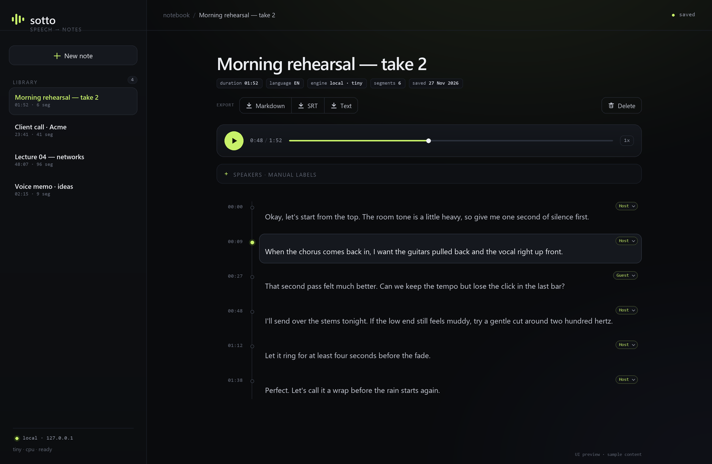

# sotto

**Speech in, notes out.** A small local-first web app that turns audio recordings into
editable, timestamped notes — then exports Markdown, SRT or plain text.

No account, no cloud required, no build step. The server is Python's standard library
plus faster-whisper; the interface is one HTML page with vanilla JS.



*UI preview — sample content, rendered with Pillow from the same layout and palette as
`static/style.css`. It is not a live screenshot.*

## Features

- Drag and drop an audio file, or pick one from disk. Files are copied into a local
  library, so moving the original does not break the note.
- Local transcription with **faster-whisper** (`tiny`, CPU, int8) — no API key, no
  audio leaving the machine. The model is downloaded once on first use.
- A timestamped timeline. Click a timestamp to seek; the segment under the playhead
  highlights as audio plays. Playback speed cycles 1x → 1.25x → 1.5x → 2x.
- Edit segment text inline and rename the note; edits autosave to disk.
- **Manual** speaker labels (S1–S4 plus display names). Labels appear in every export.
  There is no automatic diarization — see [Limitations](#limitations).
- Export to **Markdown**, **SRT** or **plain text** with the click of a button.
- A note library on disk: one JSON file plus the audio per note. No database.
- Optional OpenAI-compatible cloud adapter, off unless an API key is set.
- Works offline after the first model download; single background transcription worker.

## Requirements

- **Python 3.10+** (developed and tested with Python 3.12.14).
- **Roughly 150–200 MB of disk** for the Python dependencies and **about 75 MB** for the
  default `tiny` model, downloaded on first transcription.
- CPU is enough; no GPU is required.
- *Optional:* `ffmpeg`/`ffprobe` on `PATH`. Duration is best-effort: faster-whisper
  decodes audio itself, and `ffprobe` is only a fallback when the decoder does not
  report a duration. The app runs without it.

## Install

From the project folder:

```powershell
python -m venv .venv
.venv\Scripts\activate          # Windows
# source .venv/bin/activate     # macOS / Linux
pip install -r requirements.txt
```

`requirements.txt` pins what was verified on this machine:

```text
faster-whisper==1.2.1
av==15.1.0
```

`av` is pinned deliberately: with `av` 19, faster-whisper 1.2.1 fails while decoding
audio (`TypeError: open() got an unexpected keyword argument 'metadata_errors'`).
`av==15.1.0` avoids that. `pip install -e .` also works if you prefer the
`pyproject.toml` route (and gives you a `sotto-notes` console command).

## Run

```powershell
python -m sotto_notes
```

or double-click `run.bat`, or run `.\run.ps1` in PowerShell (if the execution policy blocks
it, use `powershell -ExecutionPolicy Bypass -File run.ps1`). The launchers look for
`.venv`, then `py -3`, then `python`, install the dependencies if faster-whisper is
missing, and start the server. They do **not** create a virtualenv for you.

Then open **http://127.0.0.1:8765** (the app opens it for you unless `--no-browser`).

```text
python -m sotto_notes --no-browser          # do not open a tab
python -m sotto_notes --port 9000           # different port
python -m sotto_notes --host 0.0.0.0        # expose on the LAN (be careful)
python -m sotto_notes --check               # show engine availability and exit
```

On first transcription, faster-whisper downloads
[`Systran/faster-whisper-tiny`](https://huggingface.co/Systran/faster-whisper-tiny)
(about 75 MB) into the Hugging Face cache (normally `~/.cache/huggingface`). This needs
network access once. Later runs are offline.

## Using it

1. Drop an audio file on the drop zone (or click to pick one). Supported extensions:
   `.mp3 .wav .m4a .mp4 .ogg .opus .flac .webm .aac`, up to 512 MB.
2. Leave the engine on **Local (faster-whisper)**, or pick the cloud engine if it is
   configured. A progress view shows the stage and rough percentage.
3. When the note opens: click a timestamp or a segment to seek, play/pause with the
   player, edit the title and any segment text. Changes save automatically (the top
   right shows `saved`, `saving…` or `unsaved`).
4. Open **Speakers · manual labels** to name S1–S4. Every segment has a small speaker
   chip; choose who is speaking. Export includes the names.
5. Export via **Markdown / SRT / Text**. The downloaded file is named after the note.

## Where the data lives

Default data directory: `~/.sotto-notes` (`C:\Users\<you>\.sotto-notes` on Windows).
Override with `SOTTO_DATA_DIR`.

```text
~/.sotto-notes/
  notes/
    0123456789ab.json     # the whole note: metadata, speakers, segments
  audio/
    0123456789ab.mp3      # a copy of the uploaded file
  tmp/                    # uploads while a job runs; cleaned up afterwards
```

A note JSON holds `title`, `source_filename`, `duration`, `language`, `provider`,
`model`, `speakers` (S1–S4 display names) and `segments` (`start`, `end`, `text`,
`speaker`). Deleting a note in the UI removes both its JSON and its audio copy.
The library is just those files — back it up by copying the folder.

## Optional cloud engine

The cloud adapter speaks the OpenAI audio-transcription API (multipart upload,
`verbose_json` segments). It is listed as unavailable and disabled until a key exists.
Set these before starting the server:

```powershell
$env:SOTTO_CLOUD_API_KEY = "sk-..."
# optional:
$env:SOTTO_CLOUD_BASE_URL = "https://api.openai.com/v1"
$env:SOTTO_CLOUD_MODEL = "whisper-1"
python -m sotto_notes
```

The endpoint must return `verbose_json` with `segments`; if it returns plain text only,
the whole transcript becomes one segment. In cloud mode the audio is uploaded to the
endpoint you configure. **This adapter is implemented but was not exercised in the
0.1.0 verification run** (no key was available).

## Configuration

| Variable | Default | Meaning |
| --- | --- | --- |
| `SOTTO_HOST` | `127.0.0.1` | Bind address |
| `SOTTO_PORT` | `8765` | Port |
| `SOTTO_DATA_DIR` | `~/.sotto-notes` | Notes, audio and scratch space |
| `SOTTO_WHISPER_MODEL` | `tiny` | Any faster-whisper model name/size (`base`, `small`, …) |
| `SOTTO_WHISPER_DEVICE` | `cpu` | `cpu` or `cuda` |
| `SOTTO_WHISPER_COMPUTE` | `int8` | CTranslate2 compute type |
| `SOTTO_LANGUAGE` | auto | Force a language code, e.g. `en` |
| `SOTTO_CLOUD_API_KEY` | _(empty)_ | Enables the cloud engine |
| `SOTTO_CLOUD_BASE_URL` | `https://api.openai.com/v1` | OpenAI-compatible base URL |
| `SOTTO_CLOUD_MODEL` | `whisper-1` | Transcription model name |

Command-line `--host`/`--port` win over the environment variables.

## Tests and self-check

```powershell
python -m unittest discover -s tests -v
python scripts/selfcheck.py --audio path\to\audio.mp3
```

The unit tests cover exporters, store validation and provider plumbing (no model load).
`selfcheck.py` validates the repository layout, then optionally transcribes a real file
with the local engine and prints the segments and a Markdown excerpt.

## Verified in this build

Development machine: Windows 11, CPU only, Python 3.12.14, faster-whisper 1.2.1,
`tiny` / `int8`.

- `python -m unittest discover -s tests -v` → **20 tests, OK**.
- `python scripts/selfcheck.py --audio a.mp3` transcribes a 6.504 s clip, `language=zh`,
  two segments. Actual output:

  ```text
  [   0.00 ->    2.08] 老大,我是小木
  [   2.08 ->    5.84] 这样说话的声调,会不会更软一点啊
  ```

- End-to-end over HTTP against a server on `127.0.0.1:8799` with a temporary data
  directory: upload → job `done` → note JSON with 2 segments; edit via `PUT` →
  speakers/segments persisted; Markdown, SRT and text exports returned with correct
  MIME types and attachment filenames; media served with HTTP Range (`206 Partial
  Content`, `Content-Range: bytes 0-1023/39024`); unknown note and path traversal
  returned 404.
- A 6.5 s clip took roughly 30 s including the one-time model load on this CPU. That is
  a single observation, not a benchmark; longer files scale with duration.

## Limitations

- **No automatic speaker diarization.** Speakers are labeled by hand (S1–S4 and display
  names). The app does not pretend to guess voices.
- Local mode runs **one transcription at a time**; uploads wait in a queue. No
  cancellation yet.
- The default `tiny` model is the fastest and the least accurate. Larger models
  (`SOTTO_WHISPER_MODEL=base`, `small`, …) transcribe better but need more time and RAM
  and a larger download. Only `tiny` was verified here.
- Uploads are capped at 512 MB. Very long recordings mean long CPU jobs and a large
  browser timeline.
- The browser plays the original file through `<audio>`; a container accepted for
  transcription may still not play in every browser (the timeline and exports are
  unaffected).
- No waveform, no audio editing, no streaming/partial transcription, no search across
  notes.
- Every note starts from an audio upload; there is no text-only note editor. The
  "New note" button clears the current view and returns to the upload zone.
- Only Windows 11 + CPU was verified. The code uses only the standard library +
  faster-whisper, so macOS/Linux should work with `python -m sotto_notes`, but that was
  not tested. The `run.bat` / `run.ps1` launchers were not exercised in the verification
  run (the machine used a bundled Python runtime rather than a system Python on `PATH`).
- The cloud adapter is untested (see above).

## Project layout

```text
sotto_notes/
  __main__.py       # CLI: --host, --port, --no-browser, --check
  config.py         # environment-driven paths and defaults
  providers.py      # local faster-whisper + optional OpenAI-compatible adapter
  server.py         # http.server routes, uploads, job queue, Range responses
  store.py          # atomic JSON notes, validation, library listing
  export.py         # Markdown, SRT, plain text
static/
  index.html, style.css, app.js, favicon.svg
tests/              # unittest suite
scripts/selfcheck.py
scripts/make_preview.py   # regenerates docs/ui-preview.png
docs/ui-preview.png
run.bat, run.ps1
requirements.txt, pyproject.toml, LICENSE
```

A short architecture note: the server exposes `/api/transcribe`, `/api/jobs/<id>`,
`/api/notes`, `/api/export/<id>?format=`, `/media/<id>` and `/api/providers`. Uploads
are job-queued; the browser polls the job, then loads the saved note. All state is the
files in the data directory. The front end is deliberately a plain DOM app with no
framework and no build step.

## Credits

Inspired by [Kikoe](https://github.com/first-storm/Kikoe), a Python/GTK4 app that also
turns speech into timestamped, speaker-labeled notes. **sotto is an independent,
original implementation**: a web UI instead of GTK4, a different server and data model,
and no code copied from that project.

Transcription is powered by [faster-whisper](https://github.com/SYSTRAN/faster-whisper)
(CTranslate2) and OpenAI's Whisper model weights. Icons are inline SVG, and the UI uses
the system font stack.

## License

MIT — see [LICENSE](LICENSE). Copyright (c) 2026 Zhiyu Zhang.
